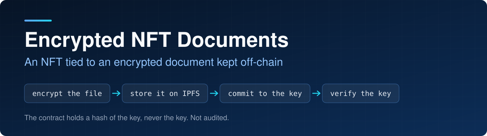
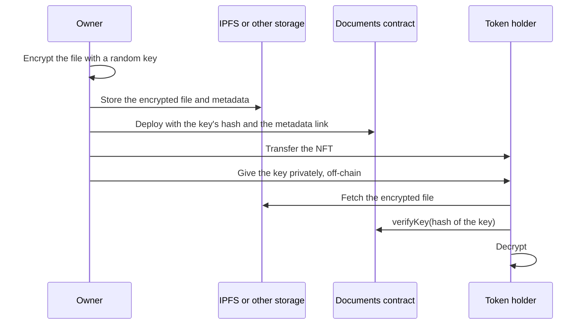

<p align="center">
  
</p>

<p align="center">
  
<a href="https://github.com/CoinClubQuincy/EncryptedNFT-Documents/actions/workflows/build.yml"></a>        
</p>

<p align="center">
  <a href="#how-it-works">How it works</a> · <a href="#try-it">Try it</a> · <a href="#what-is-tested">What is tested</a> · <a href="#known-issues">Known issues</a>
</p>

This project ties an NFT to an encrypted document stored off-chain, such as on IPFS. The token's metadata points to the encrypted file. The contract stores only a hash of the decryption key, so someone who is given the key off-chain can confirm it is the right one.

> [!CAUTION]
> **Never put a decryption key in a contract, on any network that others can read.** Earlier versions stored it there, gated by a view function, and that did not hide it: anyone can read contract storage. Keys already stored in a deployed version are public and cannot be removed, so treat those documents as exposed. This contract has not been audited and has not run on a real network.

## How it works



| Function | What it does |
| --- | --- |
| `constructor(keyCommitment, uri)` | Stores the hash of the key and mints the NFT to the deployer |
| `viewKeyCommitment()` | Returns the stored hash |
| `verifyKey(keyHash)` | Tells you whether a hash matches |
| `uri(0)` | Returns the metadata link |

[`URI/metadata.json`](URI/metadata.json) is an example of the metadata.

**Choosing a key.** Use a long random key from a cryptographic generator. The earlier instructions built the key as the SHA-256 of the image's hash plus a fixed word. That is weak, because the metadata publishes the image's hash, so anyone could work out the key by guessing the word.

**Encrypting.** Use an established tool such as `age` or AES-GCM. The earlier instructions pointed to [safedun-server](https://github.com/adildsw/safedun-server), which describes itself as image scrambling. Scrambling is not the same as encryption, so don't rely on it to protect documents. This repo used to include it as a broken submodule link, which has been removed.

## Try it

```bash
git clone https://github.com/CoinClubQuincy/EncryptedNFT-Documents.git
cd EncryptedNFT-Documents
git clone --depth 1 -b v4.9.6 https://github.com/OpenZeppelin/openzeppelin-contracts lib/openzeppelin-contracts
git clone --depth 1 -b v1.9.7 https://github.com/foundry-rs/forge-std lib/forge-std
forge test
```

You need [Foundry](https://getfoundry.sh).

## What is tested

[`test/foundry/Documents.t.sol`](test/foundry/Documents.t.sol) has 6 tests, including one fuzz test, and runs in CI on every push. They cover the deployer holding the token, requiring a commitment, verifying only the right key, selling the token, and storage holding only the commitment. It has not been run on a real network or audited, and the encryption and key delivery are not part of this repo, so they are not tested.

## Changes from earlier versions

Contracts already deployed are unaffected, and **any key they store stays public**.

- The constructor takes a hash of the key instead of the key.
- `viewKey` was replaced by `viewKeyCommitment` and `verifyKey`.
- The broken `safedun-server` submodule link and the older Truffle test were removed.

## Known issues

| Issue | Effect |
| --- | --- |
| Delivering the key is up to you | The contract cannot give anyone the key. You need a private channel or a service that checks the token. That service must first have the holder sign a fresh random challenge, because `balanceOf` alone doesn't prove someone controls the address |
| Selling the token does not take back the key | A past holder who has the key can still decrypt. Encrypt again with a new key if that matters |
| A weak key can be guessed from its hash | The hash is public, so use a long random key |
| Metadata stored off-chain can disappear | If nobody keeps the IPFS file pinned, it can become unavailable |

<details>
<summary><strong>More XDC and EVM projects</strong></summary>

| Group | Project | What it is |
| --- | --- | --- |
| Standards | [XRC-SHARES](https://github.com/CoinClubQuincy/XRC-SHARES) | Dividend-paying NFT shares and SPLITS for a DApp |
| Standards | [XRCDividendPlus](https://github.com/CoinClubQuincy/XRCDividendPlus) | Dividend-paying XRC-20 token |
| Treasury and finance | [Multi-Sig-Treasury](https://github.com/CoinClubQuincy/Multi-Sig-Treasury) | Treasury controlled by tokenized keys |
| Treasury and finance | [XRC-Airdrop](https://github.com/CoinClubQuincy/XRC-Airdrop) | Self-run token airdrop |
| Treasury and finance | [XRC-Credit](https://github.com/CoinClubQuincy/XRC-Credit) | Single-loan credit contract |
| Treasury and finance | [XDC-Defi-Instruments](https://github.com/CoinClubQuincy/XDC-Defi-Instruments) | Assets, agreements, forwards, futures and a marketplace |
| Treasury and finance | [XRC1155-Equities-Market](https://github.com/CoinClubQuincy/XRC1155-Equities-Market) | Shares, portfolios and a marketplace on ERC-1155 |
| Treasury and finance | [NFTOTC](https://github.com/CoinClubQuincy/NFTOTC) | Over-the-counter sale of a token collection |
| Treasury and finance | [DAppProxySwap](https://github.com/CoinClubQuincy/DAppProxySwap) | Currency swaps for a DApp through a fixed router |
| Identity and access | [LoginMFAContract](https://github.com/CoinClubQuincy/LoginMFAContract) | Login with an NFT and a signed second factor |
| Identity and access | [PrivateAccessToken](https://github.com/CoinClubQuincy/PrivateAccessToken) | Token access to encrypted off-chain data |
| Identity and access | [Delegated_Authority](https://github.com/CoinClubQuincy/Delegated_Authority) | KYC notary proof of concept |
| Learning and libraries | [XDC-LemonadeStand](https://github.com/CoinClubQuincy/XDC-LemonadeStand) | Workshop DApp built on XRC-SHARES |
| Learning and libraries | [Non-Financial-SmartContracts](https://github.com/CoinClubQuincy/Non-Financial-SmartContracts) | Games, inventory, keys and on-chain repositories |
| Learning and libraries | [ContractLedger](https://github.com/CoinClubQuincy/ContractLedger) | On-chain list of contract addresses |
| Learning and libraries | [TimestampConverter](https://github.com/CoinClubQuincy/TimestampConverter) | Timestamps to calendar dates in Solidity |
| Tools | [XDC_Python_SDK_V1](https://github.com/CoinClubQuincy/XDC_Python_SDK_V1) | Python client for the XDC JSON-RPC API |
| Tools | [PrivateXDCNode_SetupScript](https://github.com/CoinClubQuincy/PrivateXDCNode_SetupScript) | Private XDC network setup scripts |
| Tools | [WebApp_to_XDCPay](https://github.com/CoinClubQuincy/WebApp_to_XDCPay) | Working web app connected to XDCPay |
| Multi-chain | [CoinClub_Framework](https://github.com/CoinClubQuincy/CoinClub_Framework) | Python library with an XDC adapter |
| Interfaces | [Contract_Interface_Model_Language](https://github.com/CoinClubQuincy/Contract_Interface_Model_Language) | Interface documents for smart contracts and APIs |

</details>

## License

[MIT](LICENSE).
